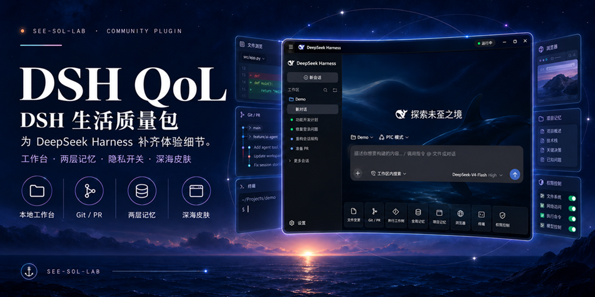
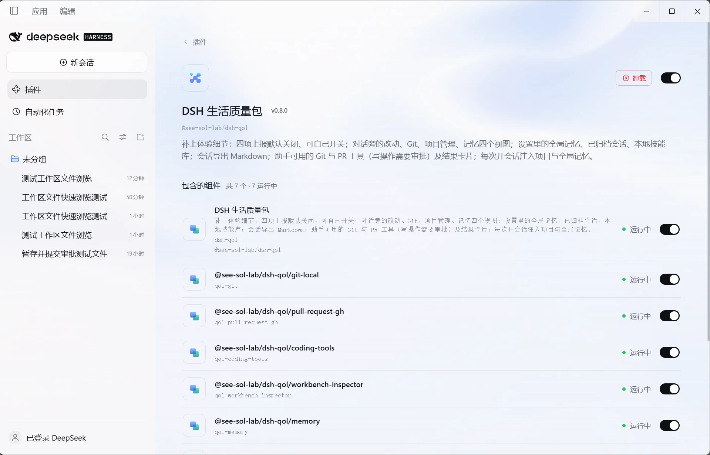

<h1 align="center">DSH QoL Pack</h1>

<a href="README.md">中文</a> · <strong>English</strong>

<b>A plugin that fills in the everyday details of the official DeepSeek Harness desktop app.</b>

  
  
  
  
  

A plugin for the official DeepSeek Harness (DSH) desktop app. The name comes from the "Quality of Life" updates in games: no big new gameplay, just the small things done right.

This is an unofficial community project and is not affiliated with DeepSeek or Hangzhou DeepSeek.

## Where it comes from

The plugin grew out of [DeepSeekGUI](https://github.com/See-Sol-Lab/DeepSeekGUI), a community desktop workbench built on DSH. It added a local Git workbench, memory, a skill library, usage statistics, system notifications and a deep-sea glass skin on top of DSH, and merged every official update in full.

Since the official desktop app arrived, its direction has diverged from DeepSeekGUI's, and merging every official update by hand became more than one maintainer could keep up with. So DeepSeekGUI changed course:

- **No more full merges of official updates.** DeepSeekGUI only receives basic maintenance.
- **The features the official app doesn't have yet live on in this plugin**, installed into the official desktop app. DeepSeekGUI users who switch to the official app and add the QoL Pack get an experience close to DeepSeekGUI. Existing DeepSeekGUI users will move over to the official desktop app with the QoL Pack seamlessly through the rc.3 update, and their experience stays the same.
- The plugin only touches what the official app opens to plugins and never patches official code, so it keeps working across official updates.

## Features

| Feature | Where | Default |
|---|---|---|
| Remove the sandbox Low integrity label automatically | Settings → QoL Pack → Sandbox | On |
| Repair workspace sandbox permissions automatically | Settings → QoL Pack → Sandbox | On |
| DeepSeekGUI skin | Everywhere; Settings → QoL Pack → Skin | On |
| Privacy and reporting switches | Settings → QoL Pack → Privacy | All four reports off |
| Workbench: Changes, Git, Project, Memory | Tabs beside the conversation | On |
| Project and global memory | Memory tab; Settings → Global memory | On |
| Archived sessions | Settings → Archived sessions; session menu | On |
| Local skill library | Settings → Skill; Project tab | On |
| Usage and balance | Settings → Usage and balance | On |
| Smooth streaming text | Conversation | On |
| Git and PR tools | Tools for the assistant, shown as result cards | On; write actions need approval |
| Export a session as Markdown | Session menu | On |
| System notifications | Windows notifications | On |
| Vision hint | Context for the assistant | On |

*After installation: the QoL Pack on the official Plugins page, with all 7 components running.*

The two sandbox switches fix long-standing Windows issues in the official sandbox: workspaces permanently left with a Low integrity label (which breaks Electron, build tools and virtual environments for other tools too), and `SetNamedSecurityInfoW failed (Win32 5)` on every command when the workspace is on a drive other than C:.

The full description of every feature, with screenshots, is in the [Chinese README](README.md). The plugin's interface follows the language of the official app.

## License

[MIT](LICENSE). Parts of the code come from DeepSeek Harness (MIT). Please credit the source when you cite or reuse it.
