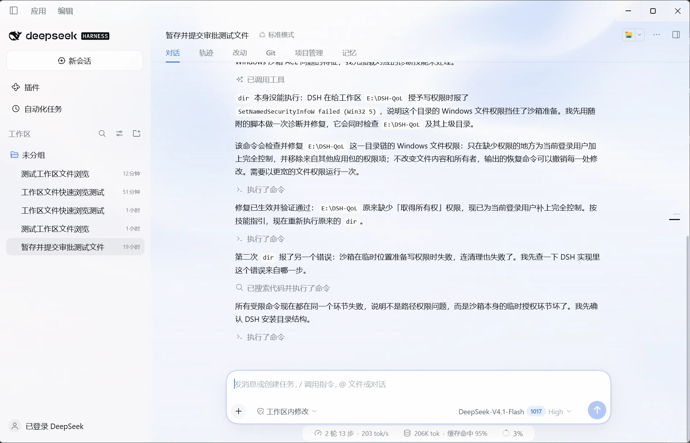
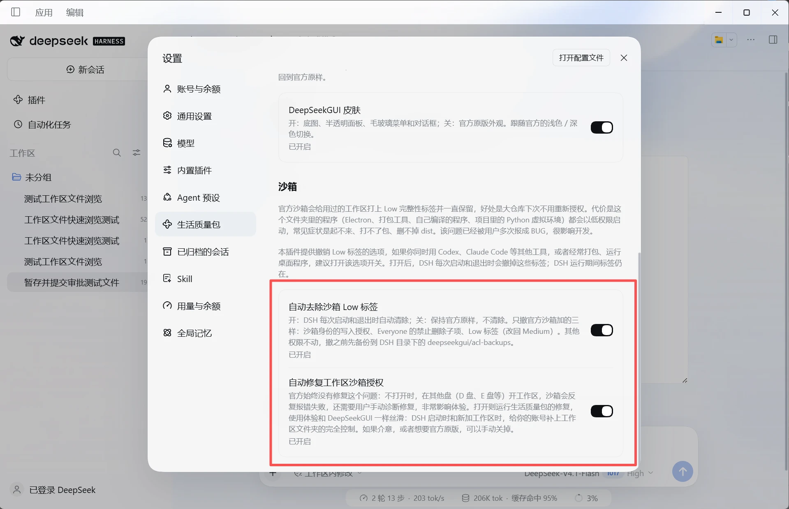
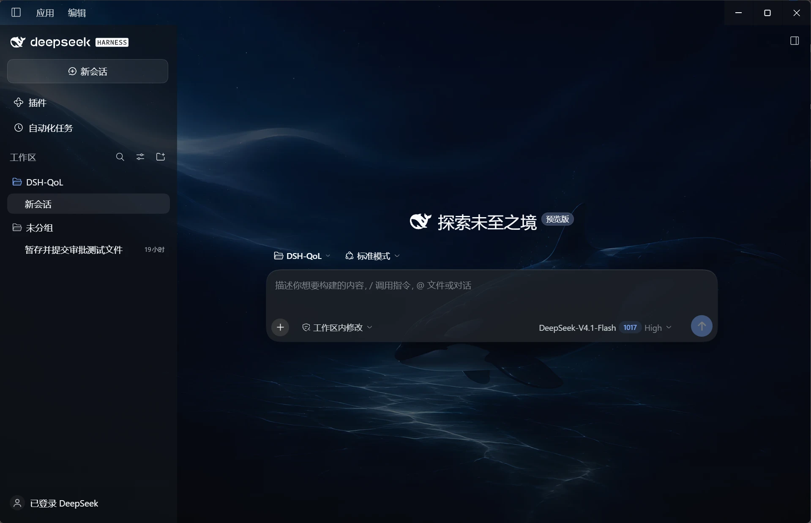
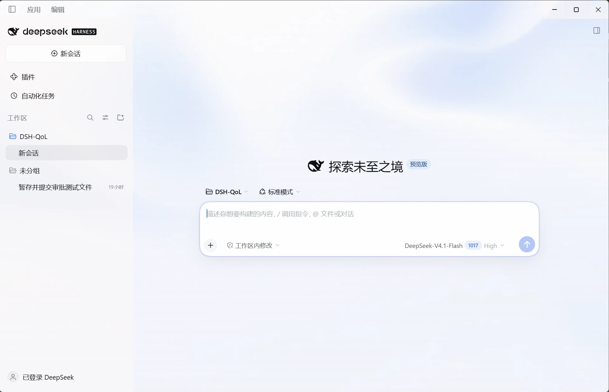
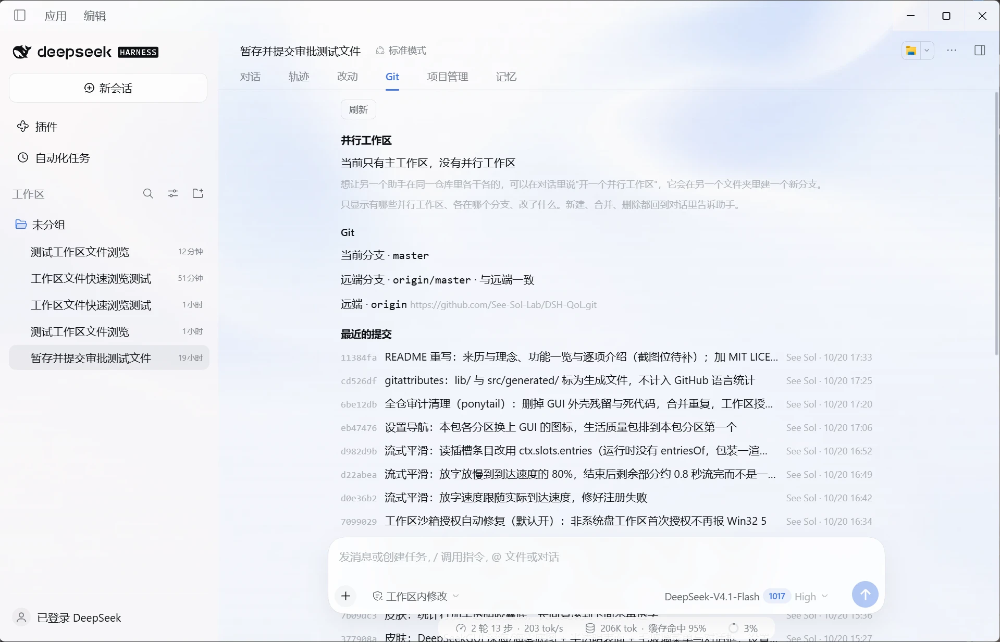
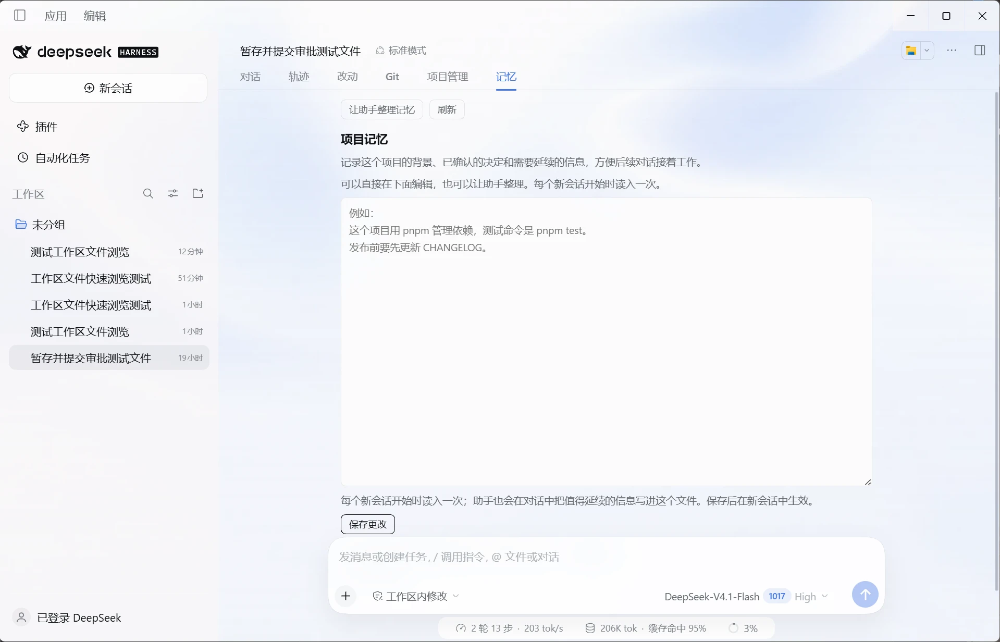
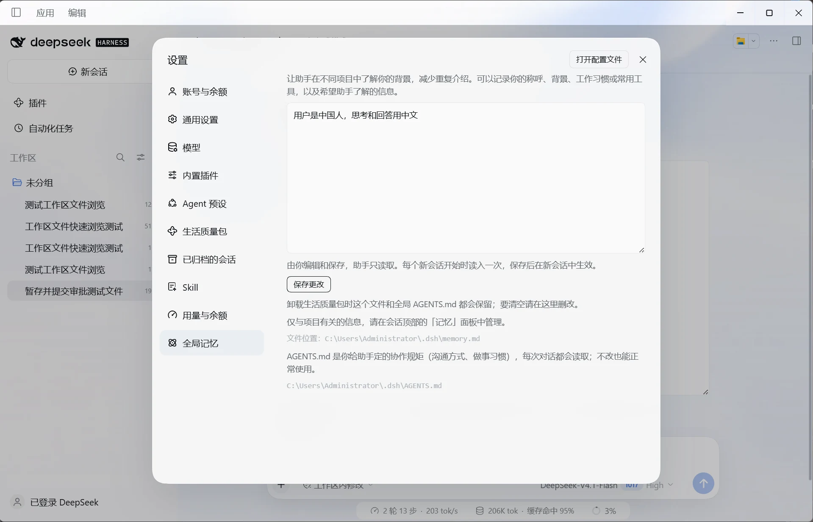
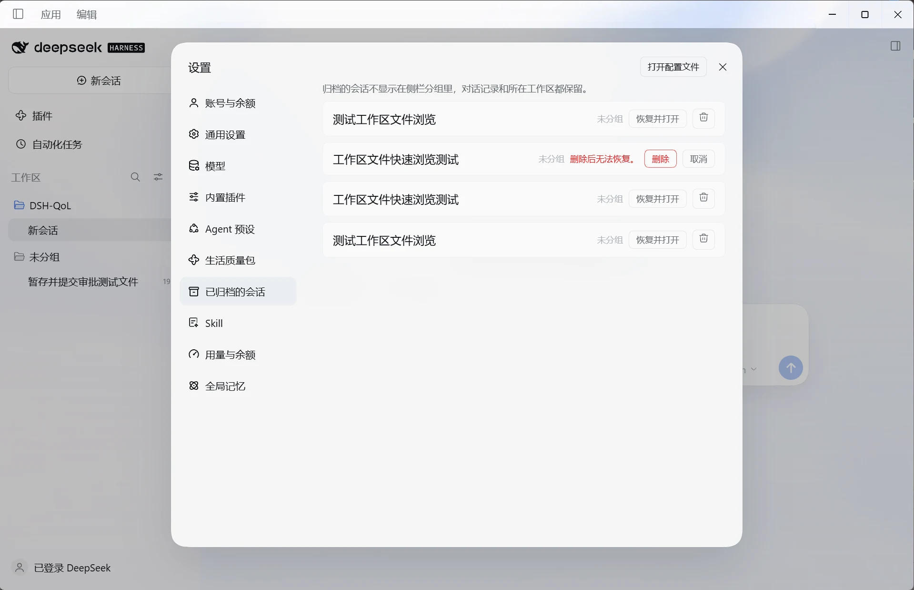
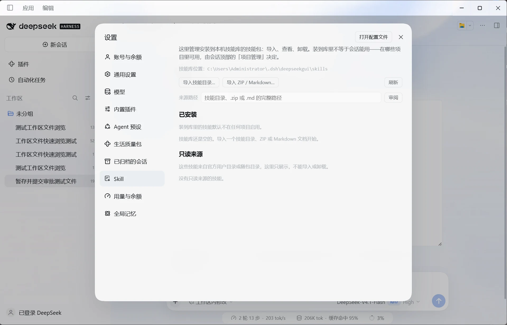
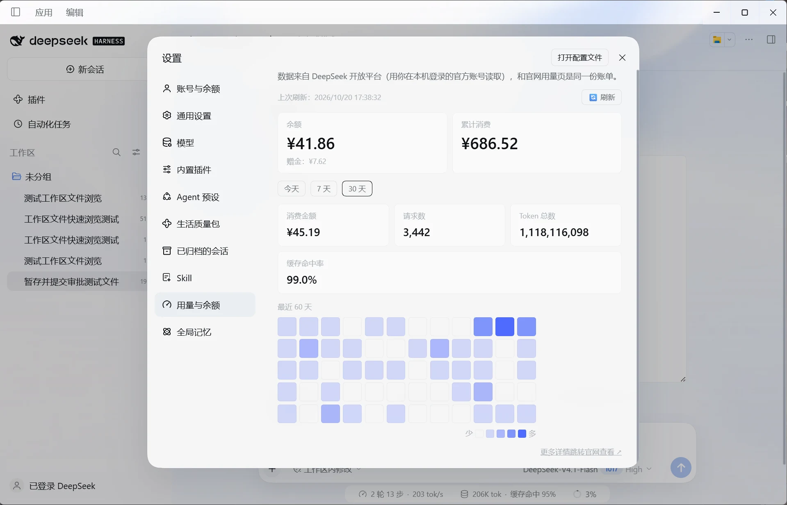

<p align="center"></p>

<h1 align="center">DSH 生活质量包</h1>

<p align="center"><strong>中文</strong> · <a href="README.en.md">English</a></p>
<p align="center"><b>给 DeepSeek Harness 官方桌面端补上体验细节的插件。</b></p>

<p align="center">
  <a href="LICENSE"></a>
  
  
  
</p>

给 DeepSeek Harness（DSH）官方桌面端补上一批体验细节的插件。名字借自游戏里的 Quality of Life （生活质量）更新：不加大玩法，把细节补齐。

本插件是非官方的社区作品，与 DeepSeek及深度求索 无隶属关系。

## 来历与理念

本插件源自 [DeepSeekGUI](https://github.com/See-Sol-Lab/DeepSeekGUI)。DeepSeekGUI 是基于DSH开发的社区桌面工作台：一个独立的桌面应用，在 DSH 之上加了本地 Git 工作台、记忆、技能库、用量统计、系统通知和深海玻璃皮肤等功能，每个版本都完整合并官方更新。

官方推出自己的桌面端以后，官方桌面端的更新方向、开发理念与 DeepSeekGUI 有不小的分歧，而 DeepSeekGUI 由一个人维护，每次整体合并官方更新、再把自己的改动接回去，工作量越来越大，也越来越难跟上。所以 DeepSeekGUI 调整了方向：

- **不再整体合并官方更新**。DeepSeekGUI 只做基础维护。
- **把官方还没有的功能做成这个插件**，装进官方桌面端。DeepSeekGUI 的老用户换到官方桌面端、装上生活质量包，就能得到和 DeepSeekGUI 相近的使用体验。GUI的老用户将在rc3合并更新中直接无缝过渡到官方桌面端+QoL质量包。使用体验保持不变。
- 插件只改官方开放给插件的部分，不改官方代码，所以官方更新以后插件照常可用，维护量小得多。

如果你是第一次接触这个插件，下面的功能介绍会逐项说明它从哪些方面改善了官方桌面端的使用体验。

## 功能一览

| 功能 | 在哪里 | 默认 |
|---|---|---|
| [自动去除沙箱 Low 标签](#沙箱官方一直没修的两个问题) | 设置 → 生活质量包 → 沙箱 | 开 |
| [自动修复工作区沙箱授权](#沙箱官方一直没修的两个问题) | 设置 → 生活质量包 → 沙箱 | 开 |
| [DeepSeekGUI 皮肤](#deepseekgui-皮肤) | 全局；设置 → 生活质量包 → 皮肤 | 开 |
| [隐私与上报开关](#隐私与上报) | 设置 → 生活质量包 → 隐私与上报 | 四项上报全关 |
| [工作台：改动、Git、项目管理、记忆](#工作台) | 对话旁的标签 | 开 |
| [项目记忆与全局记忆](#记忆) | 记忆标签；设置 → 全局记忆 | 开 |
| [已归档的会话](#已归档的会话与本地技能库) | 设置 → 已归档的会话；会话菜单 | 开 |
| [本地技能库](#已归档的会话与本地技能库) | 设置 → Skill；项目管理标签 | 开 |
| [用量与余额](#用量与余额) | 设置 → 用量与余额 | 开 |
| [流式正文平滑显示](#其他) | 对话 | 开 |
| [Git 与 PR 工具](#其他) | 助手可用的工具，对话里显示结果卡片 | 开，写操作需审批 |
| [会话导出为 Markdown](#其他) | 会话菜单 | 开 |
| [系统通知](#其他) | Windows 系统通知 | 开 |
| [看图提示](#其他) | 给助手的上下文 | 开 |

[](docs/media/plugin-page.webp)
*装好后，官方「插件」页里的生活质量包，7 个组件都在运行。*

## 功能介绍

### 沙箱：官方一直没修的两个问题

官方桌面端的沙箱在 Windows 上有两个让人头疼的问题，用户反复报过，官方一直没修。生活质量包把它们都解决了，两个开关默认都开。

**问题一：工作区被永久打上 Low 标签。** 官方沙箱会给用过的工作区打上 Low 完整性标签并一直保留，好处是大仓库下次不用重新授权。代价是这个文件夹里的程序（Electron、打包工具、自己编译的程序、项目里的 Python 虚拟环境）都会以低权限启动，常见症状是起不来、打不了包、删不掉 dist。如果你同时用 Codex、Claude Code 等其他工具开发同一个项目，它们也会被这个标签挡住。

→ **自动去除沙箱 Low 标签**：DSH 每次启动和退出时撤掉官方沙箱加的三样（沙箱身份的写入授权、Everyone 的禁止删除子项、Low 标签改回 Medium）；DSH 运行期间标签仍在，助手照常工作。关掉 DSH 以后，工作区就是干净的，其他工具不受影响。其他权限不动，撤之前先备份到 DSH 目录下的 `deepseekgui/acl-backups`。

**问题二：在其他盘开工作区，沙箱命令全部失败。** 官方沙箱第一次授权工作区时需要「更改所有者」权限，而 D 盘、E 盘这些盘上的文件夹默认没有给你。结果是在这些盘上开工作区，助手每跑一条命令都报 `SetNamedSecurityInfoW failed (Win32 5)`，只能手动跑诊断修复；助手自己去修，还可能把权限改乱。

→ **自动修复工作区沙箱授权**：DSH 启动时和新加工作区时，给你的账号补上工作区文件夹的完全控制，使用体验和 DeepSeekGUI 一样丝滑。只处理注册过的工作区，不碰盘符根目录和系统目录。

两个开关在「设置 → 生活质量包 → 沙箱」里，介意的话可以关掉，回到官方原版。

另外，生活质量包会告诉助手它对沙箱做了什么，并要求助手遇到沙箱权限报错时先停下来，把报错原文给你看、说明可能的原因，由你决定，不自己去改文件夹权限或运行修复。

| 官方原版：沙箱授权失败，命令跑不起来 | 生活质量包：设置里的两个沙箱开关 |
| --- | --- |
| [](docs/media/sandbox-error.webp) | [](docs/media/sandbox-settings.webp) |

### DeepSeekGUI 皮肤

把 DeepSeekGUI 的深海／海雾底图和半透明玻璃质感带到官方桌面端：底图铺在界面最底层，侧栏、气泡、按钮改为半透明，菜单和对话框加毛玻璃，输入框下面的统计行收成半透明胶囊，设置导航里生活质量包的各个分区换上各自的图标。只换外观，不改官方功能；跟随官方的浅色／深色切换。在「设置 → 生活质量包 → 皮肤」里可以关掉，立刻回到官方原样。

| 深色 | 浅色 |
| --- | --- |
| [](docs/media/skin-dark.webp) | [](docs/media/skin-light.webp) |

### 隐私与上报

官方桌面端默认开启四项上报：桌面产品统计、会话日志、插件清单、反馈上传。装上生活质量包后这四项**默认全部关闭**，在「设置 → 生活质量包 → 隐私与上报」里由你自己决定开哪项，当场生效。卸载插件后恢复官方默认。

### 工作台

对话、轨迹旁边多出四个标签：

- **改动**：当前工作区的未提交改动，按文件查看差异。
- **Git**：当前分支、远端、最近的提交，以及并行工作区（worktree）。
- **项目管理**：为这个项目选择启用哪些本地技能。
- **记忆**：查看、编辑项目记忆，生成项目 AGENTS.md。

[](docs/media/git.webp)

*Git 标签：并行工作区、当前分支与远端、最近的提交。*

### 记忆

每次开会话，把全局记忆（DSH 目录下的 `memory.md`）和项目记忆（工作区里的 `<文件夹名>.memory.md`）交给助手。项目记忆在记忆标签里编辑，也可以让助手整理；全局记忆在「设置 → 全局记忆」里编辑，同一页还能找到全局 AGENTS.md。文件在编辑期间被助手或别的编辑器改过时，保存会拒绝覆盖，避免互相冲掉。

| 项目记忆 | 全局记忆 |
| --- | --- |
| [](docs/media/project-memory.webp) | [](docs/media/global-memory.webp) |

### 已归档的会话与本地技能库

**已归档的会话**：官方把已归档的会话混在侧栏的树里，要从「视图选项」打开才看得到。生活质量包在设置里单独列出它们，可以恢复并打开，也可以删除（删除前会再确认一次）；会话菜单里对已归档的会话也多了「删除」。只删已归档且没在运行的会话。

**本地技能库**：在「设置 → Skill」里从技能目录、ZIP 或 Markdown 安装、查看、卸载本地技能；装进库里的技能默认不在任何项目启用，在项目管理标签里为每个项目单独选择。

| 已归档的会话 | 本地技能库 |
| --- | --- |
| [](docs/media/archived.webp) | [](docs/media/skills.webp) |

### 用量与余额

用你在本机登录的官方账号，从 DeepSeek 开放平台读取余额、赠金、累计消费，今天／7 天／30 天的消费、请求数、Token 数和缓存命中率，以及最近 60 天的用量热力图，和官网用量页是同一份账单。登录令牌只在本机的 DSH 后台使用，只发往开放平台本身。

[](docs/media/usage.webp)

*设置里的用量与余额：余额、消费统计和 60 天热力图。*

### 其他

- **流式正文平滑显示**：模型的回复是一阵一阵到达的，官方收到多少就画多少，看起来一顿一顿。生活质量包按实际到达的速度匀速放出正文，回复结束时剩下的部分很快流完。只改显示节奏，最终显示的就是模型的原文。
- **Git 与 PR 工具**：给助手的一组工具（`git_status`、`git_diff`、`git_stage`、`git_unstage`、`git_revert`、`git_commit`、`git_push_preview`、`git_push`、`pr_availability`、`pr_existing`、`pr_create`），对话里显示为结果卡片；提交、推送、建 PR 这些写操作需要你审批。
- **会话导出为 Markdown**：会话菜单里的「导出为 Markdown」，可选是否包含工具调用和思考过程。
- **系统通知**：需要审批、助手在提问、后台工作完成或失败时弹 Windows 系统通知；窗口在前台且正看着那个会话时不打扰，点通知回到那个会话。
- **看图提示**：每一步告诉助手当前模型能不能看图。换成纯文本模型后，你让它看网页或图片，它会先问你要不要换模型，而不是反复截图又读不到。

## 开发

```bash
pnpm install
pnpm run check
```

`check` 先做类型检查再构建，产物在 `lib/`。

本地安装：完全退出官方桌面端后，用复制方式安装（链接方式下官方的共享包解析不到本包的子模块）。版本号不变时 pnpm 不会重新复制文件，所以要先 remove 再 add：

```bash
dsh plugin --profile desktop remove @see-sol-lab/dsh-qol
dsh plugin --profile desktop add file:<本仓库路径>
```

`dsh` 是官方桌面端自带的命令行，Windows 上在安装目录的 `resources\runtime\cli\bin\dsh.cmd`。

`src/generated` 里的远程接口描述由官方 Typert 生成器产出。官方生成器只认官方单仓库结构，所以借 DeepSeekGUI 仓库生成后拷回来，包名换成本包；改了远程方法签名后运行 `bash scripts/regen-typert.sh` 重新生成。

## 许可

[MIT](LICENSE)。部分代码源自 DeepSeek Harness（MIT）。引用或复用时请注明来源。
